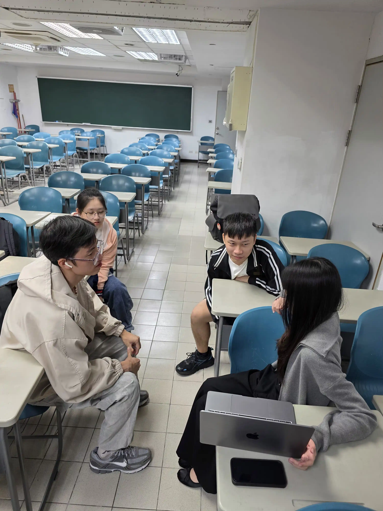

# 校園選課與課表規劃系統
## 迭代二團隊週報（Iteration 2）

### 一、基本資料

| 項目 | 內容 |
| :--- | :--- |
| 紀錄期間 | 2026 年 10 月 20 日至 10 月 29 日 |
| 本迭代目標 | 完成 F2 多層次衝堂與選課檢查、推進 F3 個人課表與空閒時段查詢，並開始 F4 需求分析與介面設計 |
| 團隊原則 | 延續 F1 的資料與程式架構，不另行建立獨立資料來源 |

### 團隊成員

* A 索云（組長）
* B 阿福
* C Steve（副組長）
* D 竹
* E 晴
* F minnn

---

## 目錄

- [一、可執行版本](#一可執行版本)
- [二、功能完成情形](#二功能完成情形)
- [三、需求與設計變更](#三需求與設計變更)
- [四、自動化測試](#四自動化測試)
- [五、版本控制紀錄](#五版本控制紀錄)
- [六、Code Review](#六code-review)
- [七、問題與缺陷](#七問題與缺陷)
- [八、Iteration Review](#八iteration-review)
- [九、團隊討論照片](#九團隊討論照片)

---

## 一、可執行版本

本迭代的程式位於 [`CampusPlanner/Code/`](../../CampusPlanner/Code/)，資料位於
[`CampusPlanner/UserData/`](../../CampusPlanner/UserData/)。

在專案根目錄執行：

```powershell
uv run python CampusPlanner/Code/Main.py
uv run pytest -q
```

### 目前模組分工

| 模組 | 檔案 | 對應功能 |
| :--- | :--- | :--- |
| 命令列介面 | `Main.py` | 選單、輸入解析與結果顯示 |
| 資料管理 | `CourseDataManager.py` | F1 課程、學生與教室資料的新增、修改、刪除、查詢 |
| 資料存取 | `StorageManager.py` | F6 依 ID 分檔讀寫與損毀檔案容錯載入 |
| 衝堂與選課檢查 | `ConflictChecker.py` | F2 |
| 課表與空閒時段 | `Timetable.py` | F3 |
| 活動與教室配置 | `VenueManager.py` | F4 |
| 共用定義 | `Constants.py`、`TimeSlotUtils.py` | 錯誤碼、規格常數與時段比對 |

本版命令列選單仍以 F1 的 11 項功能為主；F2 已完成可獨立測試的函式，但尚未接入
加選流程，F3 也尚未接入完整查詢介面。

---

## 二、功能完成情形

| 功能 | 內容 | 狀態 | 本迭代結果 |
| :--- | :--- | :--- | :--- |
| F1 | 課程與學生資料管理 | 測試通過 | 學生資料加入 `grade`；新增、修改與 CLI 尚未完整處理此欄位 |
| F2 | 多層次衝堂與選課檢查 | 測試通過 | 可一次列出學生、教室、活動、學分與人數五類限制，並依星期、節次排序；8 項測試通過 |
| F3 | 個人課表與空閒時段查詢 | 開發中 | 已完成 7×12 課表矩陣與連續空閒時段查詢；尚缺條件查詢、統計功能與測試 |
| F4 | 校園活動與教室配置 | 開發中 | 已有新增活動及可用教室篩選初版；本迭代完成需求方向整理 |
| F5 | 多條件課程篩選與可行性檢查 | 開發中 | 已有初版函式，尚未補齊測試 |
| F6 | 資料儲存與系統測試 | 測試通過 | 完成依 ID 分檔、損毀檔案略過與備份；相關測試納入總測試 |
| F7 | 多條件最佳課表搜尋 | 開發中 | 已有初版函式，尚未補齊測試 |
| F8 | 搜尋演算法比較 | 開發中 | 已有初版函式，尚未補齊測試 |
| F9 | 校園移動路徑規劃 | 開發中 | 已有初版函式與 10 個節點的校園圖資料，尚未補齊測試 |
| F10 | 動態事件與課表重新規劃 | 開發中 | 已有初版函式，尚未補齊測試 |
| F11 | AI 輔助測試與程式品質改善 | 未開始 | 尚未開始 |

---

## 三、需求與設計變更

| 日期 | 修改者 | 變更內容 | 變更原因 |
| :--- | :--- | :--- | :--- |
| 10/20–10/21 | A 索云 | 課程與學生改為依 ID 分檔；教室與校園圖分別保存於 `Classroom.json`、`CampusGraph.json`；活動改以 `event` 課程保存，學分為 0、教師為 `NPC`、時段使用日期時間戳；學生資料新增 `grade` | 統一資料模型，讓各功能共用同一份資料 |
| 10/21 | A 索云 | 將模組重新命名並拆分，集中錯誤碼與規格常數；新增 F2–F10 初版模組 | 降低模組耦合，讓後續功能可獨立開發與測試 |
| 10/27–10/28 | C Steve | 刪除舊的整份 JSON 格式與種子檔備援，`StorageManager` 統一使用 ID 分檔；`LoadDatabase` 改回傳 `(database, errors)` | 避免兩種資料格式並存造成維護與測試結果不一致 |
| 10/28 | C Steve | 移除資料庫的 `activities` 清單與學生的 `enrolled_activities` 欄位 | 活動已統一視為 `event` 課程，報名資料改記錄在 `enrolled_courses` |
| 10/28 | C Steve | F2 新增 `ALREADY_ENROLLED` 錯誤碼 | 避免重複加選被誤判為與自己衝堂 |
| 10/28 | C Steve | 將測試與執行資料中的 CS102 改至星期四第 2–4 節 | 排除 CS102 與 MA101 在 IB-101 的原有教室撞期 |
| 10/28 | C Steve | 存檔時略過內容未變動的檔案 | 避免每次操作都重寫所有課程與學生資料 |

---

## 四、自動化測試

測試位於 [`TestDriver/`](../../TestDriver/)，每個測試會將 `TestInput` 複製至暫存資料夾後
再進行操作，不會修改原始測試資料。

執行結果：

```text
uv run pytest -q
129 passed
```

| 測試分類 | 數量 | 覆蓋內容 |
| :--- | ---: | :--- |
| normal | 10 | F1 正常案例 |
| boundary | 11 | F1 邊界案例 |
| error | 10 | F1 錯誤案例 |
| extra | 38 | 參數化與細部檢查 |
| persistence | 16 | F6 分檔存取與容錯載入 |
| acceptance | 5 | 資料量、資料格式與測試資料品質 |
| cli | 31 | 命令列介面 |
| f2 | 8 | F2 衝堂與選課檢查 |
| **合計** | **129** | |

### F2 主要測試情境

`test_f2.py` 已涵蓋以下情境：

1. 新課程與已選課程、教室皆不衝突時可通過。
2. 教室衝堂、課程衝堂、活動衝突、學分超過與人數額滿同時發生時，五項限制皆會列出。
3. 時段衝突會依星期與節次排序，且第 9 節排在第 `a` 節之前。
4. 重複加選會回報 `ALREADY_ENROLLED`，不會誤報為衝堂。
5. 不存在的學生或課程會回報 `NOT_FOUND`。
6. 修改課程時，教室衝堂檢查會排除課程本身。

F3 尚未完成自動化測試；下一迭代需補上連續三節空堂、跨日查詢及同日多門課程三種
驗收情境。

---

## 五、版本控制紀錄

### A 索云（組長，分支 `Master`）

| Commit | 日期 | 內容 |
| :--- | :--- | :--- |
| `647ffb5` | 10/20 | 更新 `Reference/Formate` 的 Classroom、Course、Student 格式檔 |
| `15feb67` | 10/21 | 完成資料分檔、模組重新命名、F2–F10 初版及舊 `Code/` 清理 |
| Merge | 10/20 | 合併 PR #28（迭代一繳交內容、F6 格式檢查與教室設備檢查） |

### B 阿福（分支 `B`）

本迭代沒有 Commit。

### C Steve（副組長，分支 `C`）

| Commit | 日期 | 內容 |
| :--- | :--- | :--- |
| Merge | 10/27 | 將 `Master` 快轉合併至分支 `C` |
| `c3db2e8` | 10/28 | 移除舊 JSON 格式，並修正 `test_main.py` 的 22 個錯誤 |
| `5de6cf4` | 10/28 | 補齊 F2 驗收條件、移除多餘活動欄位、優化存檔並新增 `test_f2.py` |
| `c2b43a9` | 10/28 | 修正測試資料教室撞期、補回 S10901 及新增資料品質測試 |

### D 竹（分支 `Zhu22`、`docs/week0-D`）、E 晴（分支 `Zd`）、F minnn（分支 `minnn`）

本迭代沒有 Commit。

---

## 六、Code Review

| 日期 | 檢視對象 | 原開發者 | Reviewer | 發現與處理 |
| :--- | :--- | :--- | :--- | :--- |
| 10/20 | PR #28：迭代一內容、F6 讀檔格式與教室設備檢查 | C Steve | A 索云 | Approved，無文字意見，已合併至 `main` |
| 10/27–10/28 | `ConflictChecker.py`、`StorageManager.py`、`test_main.py` 與測試資料 | A 索云 | C Steve | 發現教室衝堂未檢查、衝突未排序、重複加選誤判、舊格式測試失效及測試資料撞期，已對應修正 D03–D09 |

`15feb67` 的系統改版直接提交於 `Master`，未經 Pull Request；分支 `C` 本迭代的修改
截至本週報紀錄時仍未開立 Pull Request。

---

## 七、問題與缺陷

缺陷編號延續迭代一的 D01、D02。

| 編號 | 模組 | 問題 | 處理方式 | Commit | 狀態 |
| :--- | :--- | :--- | :--- | :--- | :--- |
| D03 | 測試 | `test_main.py` 有 22 個測試出錯，仍指向已刪除的 `04_data_format.json` | 改用 `TestInput` 的分檔資料 | `c3db2e8` | 已修正 |
| D04 | F2 | 加選時未檢查教室衝堂 | 加入教室衝堂檢查 | `5de6cf4` | 已修正 |
| D05 | F2 | 衝突清單未依星期與節次排序 | 分離時段衝突與限制錯誤並排序 | `5de6cf4` | 已修正 |
| D06 | F2 | 重複加選被誤報為與自己衝堂 | 新增並優先檢查 `ALREADY_ENROLLED` | `5de6cf4` | 已修正 |
| D07 | 資料 | CS102 與 MA101 共用 IB-101 的相同時段 | 將 CS102 改至星期四第 2–4 節，並加入資料品質測試 | `c2b43a9` | 已修正 |
| D08 | 資料 | `UserData` 少了學生 S10901，未達 15 名驗收要求 | 從 `TestInput` 補回學生及兩門課的人數 | `c2b43a9` | 已修正 |
| D09 | F6 | 每次存檔都重寫所有課程與學生檔 | 內容未變動的檔案略過寫入 | `5de6cf4` | 已修正 |
| D10 | F6 | 第一次存檔會將由校園圖補出的教室大樓欄位寫回 `Classroom.json` | 決定是否更新資料檔或避免寫回補出的欄位 | — | 未解決 |
| D11 | F1/F2 | 新增或修改課程時尚未檢查教室撞期 | 讓 `AddCourse`、`UpdateCourse` 呼叫 `CheckClassroomConflict` | — | 未解決 |

---

## 八、Iteration Review

### 本迭代完成事項

1. F2 衝堂與選課檢查完成，能一次列出五類限制，並依星期與節次排序。
2. 資料儲存統一採用依 ID 分檔的格式；損毀檔案會略過並備份，不影響其他資料載入。
3. 修正 D03–D09 共七項缺陷，測試數由 112 項增加至 129 項，全部通過。

### 本迭代尚未完成事項

1. F2 尚未接入 CLI，尚未完成加選、退選及同步更新課程人數的完整流程。
2. F3 尚缺依星期、節次及課程代號查詢、每日上課節數與空堂數統計，也尚無自動化測試。
3. F4 的需求分析與介面設計文件尚未完成。
4. 分支 `C` 的本迭代修改尚未推送並開立 Pull Request。

### 本迭代遇到的問題

1. 系統改版未經 Pull Request 且未先執行完整測試，造成 22 個測試失敗未能即時發現。
2. F2、F3 初版由組長撰寫，與工作分解表原訂負責人不同，造成後續負責人需要先熟悉他人程式。
3. 測試資料從迭代零即存在教室撞期，直到 F2 加入教室檢查後才被揭露。

### 下一迭代改善措施

1. 所有功能修改先開立 Pull Request，並在測試全部通過及完成 Review 後合併。
2. 由工作分解表指定的負責人接手 F3、F4，先完成 F3 三種驗收情境的測試。
3. 將 F2 加選檢查接入 CLI，並讓 F1 新增、修改課程時呼叫教室衝堂檢查，以處理 D11。
4. 優先釐清 D10 的資料寫回策略，避免讀取時補值造成不必要的檔案變更。

---

## 九、團隊討論照片


