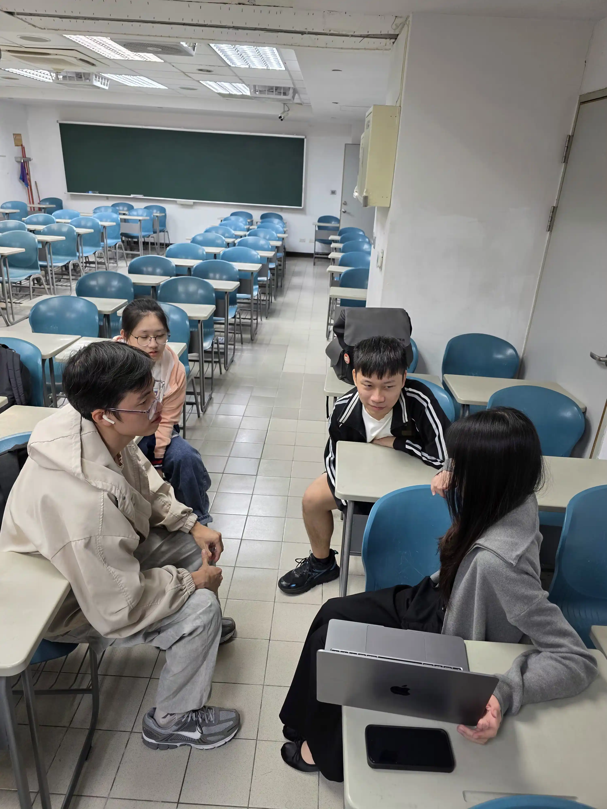

# 校園選課與課表規劃系統
## 迭代二團隊週報（Iteration 2）

### 一、基本資料

| 項目 | 內容 |
| :--- | :--- |
| 紀錄期間 | 2026 年 10 月 20 日至 11 月 8 日 |
| 本迭代目標 | 完成 F2 多層次衝堂與選課檢查、完成 F3 個人課表與空閒時段查詢，並開始 F4 需求分析與介面設計 |
| 團隊原則 | 延續 F1 的資料與程式架構，不另行建立獨立資料來源 |

### 團隊成員

* A 索云（組長）
* B 阿福
* C Steve（副組長）
* D 竹
* E 晴
* F minnn

---

## 目錄

- [一、可執行版本](#一可執行版本)
- [二、功能完成情形](#二功能完成情形)
- [三、需求與設計變更](#三需求與設計變更)
- [四、自動化測試](#四自動化測試)
- [五、版本控制紀錄](#五版本控制紀錄)
- [六、Code Review](#六code-review)
- [七、問題與缺陷](#七問題與缺陷)
- [八、Iteration Review](#八iteration-review)
- [九、團隊討論照片](#九團隊討論照片)

---

## 一、可執行版本

本迭代的程式位於 [`CampusPlanner/Code/`](../../CampusPlanner/Code/)，資料位於
[`CampusPlanner/UserData/`](../../CampusPlanner/UserData/)。

在專案根目錄執行：

```powershell
uv run python CampusPlanner/Code/Main.py
uv run python TestDriver.py
```

### 目前模組分工

| 模組 | 檔案 | 對應功能 |
| :--- | :--- | :--- |
| 命令列介面 | `Main.py` | 選單、輸入解析與結果顯示 |
| 資料管理 | `CourseDataManager.py` | F1 課程、學生與教室資料的新增、修改、刪除、查詢 |
| 資料存取 | `StorageManager.py` | F6 依 ID 分檔讀寫與損毀檔案容錯載入 |
| 衝堂與選課 | `ConflictChecker.py` | F2 衝堂檢查、加選、退選 |
| 課表與空閒時段 | `Timetable.py` | F3 |
| 活動與教室配置 | `VenueManager.py` | F4（初版） |
| 共用定義 | `Constants.py`、`TimeSlotUtils.py` | 錯誤碼、規格常數與時段比對 |

### 命令列選單（v2）

| 選項 | 功能 | 對應 |
| :--- | :--- | :--- |
| 1–11 | 課程、學生、教室的新增、修改、刪除、查詢 | F1 |
| 12 | 查看個人課表（7×12 矩陣、每日節數、總學分、空堂數、課程／活動圖例） | F3 |
| 13 | 依星期、節次、課程代號查詢個人課表 | F3 |
| 14 | 查詢連續空堂（可跨日） | F3 |
| 15 | 加選課程／報名活動（一次列出所有衝突） | F2 |
| 16 | 退選課程／取消報名 | F2 |

F2 加選失敗時的輸出（依作業規範 F2 的輸出範例）：

```text
學生：S10902 林美玲
欲加選：CLASH1 衝堂課
選課結果：失敗
衝突 1：星期四第 2、3 節
已選課程：CS102 資料結構
衝突 2：課程已額滿
人數上限：1，目前人數：1
目前學分：7
加選後學分：10
學分上限：25
```

---

## 二、功能完成情形

| 功能 | 內容 | 狀態 | 本迭代結果 |
| :--- | :--- | :--- | :--- |
| F1 | 課程與學生資料管理 | 測試通過 | 學生「系級」的年級 `grade` 已可新增、修改與顯示；新增、修改課程時檢查教室撞期 |
| F2 | 多層次衝堂與選課檢查 | 測試通過 | 學生、教室、活動、學分、人數五類限制一次列出並依星期、節次排序；加選、退選同步更新學生清單與課程人數，並接入 CLI 15、16 |
| F3 | 個人課表與空閒時段查詢 | 測試通過 | 7×12 課表、課程／活動排入、星期／節次／代碼查詢、連續空堂（含跨日）、每日節數／總學分／空堂數統計；接入 CLI 12–14，並完成三種驗收情境測試 |
| F4 | 校園活動與教室配置 | 開發中 | 完成需求分析與介面設計文件（[`F4需求分析與介面設計.md`](F4需求分析與介面設計.md)）；程式已有新增活動及可用教室篩選初版 |
| F5 | 多條件課程篩選與可行性檢查 | 開發中 | 已有初版函式，尚未補齊測試 |
| F6 | 資料儲存與系統測試 | 測試通過 | 依 ID 分檔、損毀檔案略過與備份；存檔只寫有變動的檔案；自動化測試共 157 項 |
| F7 | 多條件最佳課表搜尋 | 開發中 | 已有初版函式，尚未補齊測試 |
| F8 | 搜尋演算法比較 | 開發中 | 已有初版函式，尚未補齊測試 |
| F9 | 校園移動路徑規劃 | 開發中 | 已有初版函式與校園圖資料，尚未補齊測試 |
| F10 | 動態事件與課表重新規劃 | 開發中 | 已有初版函式，尚未補齊測試 |
| F11 | AI 輔助測試與程式品質改善 | 未開始 | 尚未開始 |

---

## 三、需求與設計變更

| 日期 | 修改者 | 變更內容 | 變更原因 |
| :--- | :--- | :--- | :--- |
| 10/20–10/21 | A 索云 | 課程與學生改為依 ID 分檔；教室與校園圖分別保存於 `Classroom.json`、`CampusGraph.json`；活動改以 `event` 課程保存，學分為 0、教師為 `NPC`、時段使用日期時間戳；學生資料新增 `grade` | 統一資料模型，讓各功能共用同一份資料 |
| 10/21 | A 索云 | 將模組重新命名並拆分，集中錯誤碼與規格常數；新增 F2–F10 初版模組 | 降低模組耦合，讓後續功能可獨立開發與測試 |
| 10/27–10/28 | C Steve | 刪除舊的整份 JSON 格式與種子檔備援，`StorageManager` 統一使用 ID 分檔；`LoadDatabase` 改回傳 `(database, errors)` | 避免兩種資料格式並存造成維護與測試結果不一致 |
| 10/28 | C Steve | 移除資料庫的 `activities` 清單與學生的 `enrolled_activities` 欄位 | 活動已統一視為 `event` 課程，報名資料改記錄在 `enrolled_courses` |
| 10/28 | C Steve | F2 新增 `ALREADY_ENROLLED` 錯誤碼 | 避免重複加選被誤判為與自己衝堂 |
| 10/28 | C Steve | 將測試與執行資料中的 CS102 改至星期四第 2–4 節 | 排除 CS102 與 MA101 在 IB-101 的原有教室撞期 |
| 10/28 | C Steve | 存檔時略過內容未變動的檔案 | 避免每次操作都重寫所有課程與學生資料 |
| 10/30 | A 索云 | 測試驅動與測試資料移到專案根目錄的 `TestDriver.py`、`TestDriver/`；`Main.py` 新增隱藏的 `import` 指令；擴充教室與校園圖資料 | 方便 CI 與組員直接在根目錄執行測試、匯入資料 |
| 10/31 | D 竹 | 完成 F3 課表產生、條件查詢、連續空堂搜尋與統計，並將三項功能接入 CLI | 完成個人課表查詢的主要使用流程 |
| 11/08 | C Steve | F2 新增 `EnrollCourse`、`DropCourse`，學生已選清單與課程人數必須在同一個函式裡一起更新；新增錯誤碼 `NOT_ENROLLED`；新報名的活動與已選課程撞時段也算活動衝突 | 避免人數與選課清單對不上；規範的活動衝突包含「活動與已選課程重疊」 |
| 11/08 | C Steve | F1 新增、修改課程時呼叫 F2 的教室衝堂檢查 | 從源頭擋下教室撞期資料（D11） |
| 11/08 | C Steve | F1 學生新增、修改流程加入年級；年級須為正整數 | 規範要求學生資料包含「系級」 |
| 11/08 | C Steve | F3 新增跨日查詢 `find_free_slots_between`，連續空堂以一天為單位、不跨越午夜；統計新增「空堂數」＝上課日中第一堂與最後一堂課之間的空節，原「整週空白節數」保留 | 規範驗收要求跨日查詢；「空堂」原本以整週空白格計算，與一般認知不同 |
| 11/08 | C Steve | 活動報名資料統一記在學生的 `enrolled_courses`，移除活動檔中的 `student_ids` | 同一份報名資料存在兩處，F2 與 F3 看到的結果不一致（D14） |

---

## 四、自動化測試

測試位於 [`TestDriver/`](../../TestDriver/)，每個測試會將 `TestInput` 複製至暫存資料夾或自行組出小型資料庫後再進行操作，不會修改原始測試資料。

執行結果：

```text
uv run python TestDriver.py
157 passed
```

| 測試分類 | 數量 | 覆蓋內容 |
| :--- | ---: | :--- |
| normal | 10 | F1 正常案例 |
| boundary | 11 | F1 邊界案例 |
| error | 10 | F1 錯誤案例 |
| extra | 43 | 參數化與細部檢查（含教室撞期、年級） |
| persistence | 16 | F6 分檔存取與容錯載入 |
| acceptance | 5 | 資料量、資料格式與測試資料品質 |
| cli | 41 | 命令列介面（F1、F2、F3 與匯入指令） |
| f2 | 12 | F2 衝堂、加選與退選 |
| f3 | 9 | F3 課表與空閒時段 |
| **合計** | **157** | **全部通過** |

### F2 測試情境（[`test_f2.py`](../../TestDriver/test_f2.py)）

| 情境 | 預期結果 |
| :--- | :--- |
| 新課程與已選課程、教室皆不衝突 | 通過 |
| 教室衝堂、課程衝堂、額滿、學分超過同時發生 | 五項全部列出，時段衝突依星期、節次排序，限制排最後 |
| 同一天第 9 節與第 `a` 節都衝堂 | 第 9 節排在第 `a` 節之前 |
| 已報名活動與新課程撞時段；新報名活動與已選課程撞時段 | 都回報 `ACTIVITY_CONFLICT` |
| 重複加選 | `ALREADY_ENROLLED`，不誤報為衝堂 |
| 學號或課程不存在 | `NOT_FOUND` |
| 修改課程時檢查教室 | 排除課程本身 |
| 加選成功 | 學生清單與課程人數一起更新 |
| 加選有衝突 | 資料完全不變 |
| 退選；再退選一次；退選不存在的課 | 人數減 1；`NOT_ENROLLED`；`NOT_FOUND` |

### F3 驗收測試（[`test_f3.py`](../../TestDriver/test_f3.py)）

| 規範驗收情境 | 測試 | 預期結果 |
| :--- | :--- | :--- |
| 7×12 課表矩陣 | `test_MatrixIsSevenDaysByTwelvePeriods` | 7 列、每列 12 節 |
| 同一天多門課程 | `test_SameDayMultipleCoursesAndRepeatedCourse` | 星期一的 A、B 都排入；一週上三次的 A 三個時段都出現 |
| 連續三節空堂 | `test_ConsecutiveThreeFreePeriods` | 只有兩節的空檔不算，四節的空檔算 |
| 跨日查詢 | `test_CrossDayQuery` | 星期一第 6 節到星期三第 4 節，每天分開列出 |
| 統計 | `test_SummaryCountsDailyPeriodsCreditsAndGaps` | 每日節數、總學分、空堂數正確 |
| 依條件查詢 | `test_QueryByDayPeriodAndCourse` | 依星期、節次、代碼篩選 |
| 活動排入課表 | `test_EnrolledActivityAppearsOnItsWeekday` | 日期時段的活動排在對應星期，不計學分 |

### 命令列測試

迭代二初期 `test_main.py` 由 31 項縮減為 3 項（D15），本迭代已補回並配合新版程式調整，另新增 F2 加選、退選與 F3 課表、跨日空堂的 CLI 測試，共 41 項。

---

## 五、版本控制紀錄

### A 索云（組長，分支 `Master`）

| Commit | 日期 | 內容 |
| :--- | :--- | :--- |
| `647ffb5` | 10/20 | 更新 `Reference/Formate` 的 Classroom、Course、Student 格式檔 |
| `15feb67` | 10/21 | 完成資料分檔、模組重新命名、F2–F10 初版及舊 `Code/` 清理 |
| `9395bad` | 10/30 | 新增迭代二課程與學生資料、擴充教室與校園圖；測試移至根目錄 `TestDriver/` |
| `51224d6` | 10/30 | 新增迭代二團隊週報 |
| `6a0d67e` | 11/06 | 更新迭代二週報的紀錄期間、目標、功能狀態與測試結果 |
| Merge | 10/20–11/06 | 合併 PR #28、#29、#30、#31、#32、#33 至 `main` |

### B 阿福（分支 `B`）

本迭代沒有 Commit。

### C Steve（副組長，分支 `C`）

| Commit | 日期 | 內容 |
| :--- | :--- | :--- |
| `c3db2e8` | 10/28 | 移除舊 JSON 格式，並修正 `test_main.py` 的 22 個錯誤 |
| `5de6cf4` | 10/28 | 補齊 F2 驗收條件、移除多餘活動欄位、優化存檔並新增 `test_f2.py` |
| `c2b43a9` | 10/28 | 修正測試資料教室撞期、補回 S10901 及新增資料品質測試 |
| `378e015` | 10/29 | 新增迭代二團隊週報初版 |
| `1d7668e` | 11/08 | F2 加選、退選接入 CLI；F1 教室撞期檢查與年級；F3 跨日查詢、空堂統計與 `test_f3.py`；補回 CLI 測試 |
| `abaa44c` | 11/08 | 活動報名資料統一記在學生的 `enrolled_courses` |
| PR | 10/29 | PR #29 合併至 `main` |

### D 竹（分支 `zhu-f3-timetable`）

| Commit | 日期 | 內容 |
| :--- | :--- | :--- |
| `67c19dd` | 10/23 | 建立 7×12 每週課表矩陣 |
| `2e31f01` | 10/27 | 連續空堂搜尋 |
| `810ec97` | 10/27 | 課表條件查詢 |
| `1bf8ee6` | 10/28 | 每日節數、總學分、空堂統計 |
| `44ecc4f` | 10/31 | 完成 F3 並接入 CLI 12–14 項 |
| PR | 11/06 | PR #32 合併至 `main` |

### E 晴（分支 `Zd`）、F minnn（分支 `minnn`）

本迭代沒有 Commit。

---

## 六、Code Review

| 日期 | 檢視對象 | 原開發者 | Reviewer | 發現與處理 |
| :--- | :--- | :--- | :--- | :--- |
| 10/20 | PR #28：迭代一內容、F6 讀檔格式與教室設備檢查 | C Steve | A 索云 | Approved，無文字意見，已合併至 `main` |
| 10/27–10/28 | `ConflictChecker.py`、`StorageManager.py`、`test_main.py` 與測試資料 | A 索云 | C Steve | 發現教室衝堂未檢查、衝突未排序、重複加選誤判、舊格式測試失效及測試資料撞期，已對應修正 D03–D09 |
| 10/29 | PR #29：F2 驗收修正與週報初版 | C Steve | A 索云 | Approved，已合併至 `main` |
| 11/06 | PR #32：F3 課表與空堂（`Timetable.py`、`Main.py`） | D 竹 | A 索云 | 由 A 索云開立並合併至 `main`，未留下 Review 意見 |
| 11/08 | `Timetable.py`、`Main.py` 的 F3 流程 | D 竹 | C Steve | 發現判斷活動用了不存在的欄位（`type`、`student_ids`）、缺少跨日查詢、「空堂數」算的是整週空白格、沒有自動化測試；已修正 D13、補上跨日查詢與 `test_f3.py` |
| 11/08 | `9395bad`（測試搬移）與 `UserData` 活動資料 | A 索云 | C Steve | 發現 CLI 測試由 31 項縮減為 3 項且 1 項失敗、活動報名資料同時記在兩處；已補回測試並統一資料（D12、D14、D15） |

`15feb67` 與 `9395bad` 直接提交於 `Master`，未經 Pull Request；PR #32、#33 合併時沒有留下 Review 意見。

---

## 七、問題與缺陷

缺陷編號延續迭代一的 D01、D02。

| 編號 | 模組 | 問題 | 處理方式 | Commit | 狀態 |
| :--- | :--- | :--- | :--- | :--- | :--- |
| D03 | 測試 | `test_main.py` 有 22 個測試出錯，仍指向已刪除的 `04_data_format.json` | 改用 `TestInput` 的分檔資料 | `c3db2e8` | 已修正 |
| D04 | F2 | 加選時未檢查教室衝堂 | 加入教室衝堂檢查 | `5de6cf4` | 已修正 |
| D05 | F2 | 衝突清單未依星期與節次排序 | 分離時段衝突與限制錯誤並排序 | `5de6cf4` | 已修正 |
| D06 | F2 | 重複加選被誤報為與自己衝堂 | 新增並優先檢查 `ALREADY_ENROLLED` | `5de6cf4` | 已修正 |
| D07 | 資料 | CS102 與 MA101 共用 IB-101 的相同時段 | 將 CS102 改至星期四第 2–4 節，並加入資料品質測試 | `c2b43a9` | 已修正 |
| D08 | 資料 | `UserData` 少了學生 S10901，未達 15 名驗收要求 | 從 `TestInput` 補回學生及兩門課的人數 | `c2b43a9` | 已修正 |
| D09 | F6 | 每次存檔都重寫所有課程與學生檔 | 內容未變動的檔案略過寫入 | `5de6cf4` | 已修正 |
| D10 | F6 | 第一次存檔會改寫 `Classroom.json` | 存檔不再寫回由校園圖補出的大樓欄位；比對內容時忽略檔尾換行 | `9395bad`、`1d7668e` | 已修正 |
| D11 | F1/F2 | 新增或修改課程時未檢查教室撞期 | `AddCourse`、`UpdateCourse` 呼叫 F2 的教室衝堂檢查 | `1d7668e` | 已修正 |
| D12 | CLI 測試 | `test_main_can_exit_without_interaction` 仍尋找舊標題 | 改為目前的「校園選課與課表規劃系統」 | `1d7668e` | 已修正 |
| D13 | F3 | 課表用 `type`、`student_ids` 判斷活動，但載入後的欄位是 `course_type`，報名資料在 `enrolled_courses`；現行資料剛好不受影響，但活動排入的邏輯實際上沒有作用 | 改用正確欄位，並加入活動排入課表的測試 | `1d7668e` | 已修正 |
| D14 | 資料 | 活動報名同時記在活動檔的 `student_ids` 與學生的 `enrolled_courses`，兩邊不一致（6 筆只記在 `student_ids`） | 統一記在 `enrolled_courses`，移除 `student_ids` | `abaa44c` | 已修正 |
| D15 | 測試 | 測試移到根目錄時，CLI 測試由 31 項縮減為 3 項 | 補回並更新至 41 項 | `1d7668e` | 已修正 |

---

## 八、Iteration Review

### 本迭代完成事項

1. F2 完成：五類限制一次列出並排序，加選、退選同步更新學生清單與課程人數，並接入 CLI。
2. F3 完成：7×12 課表、條件查詢、連續空堂（含跨日）、統計，並完成規範要求的三種驗收測試。
3. F4 完成需求分析與介面設計文件，列出規則、函式介面、錯誤碼與 10 項驗收測試規劃。
4. F1 補上年級與教室撞期檢查，完成迭代一留下的「系級」項目。
5. 修正 D03–D15 共十三項缺陷；自動化測試由 101 項（1 項失敗）增加為 157 項，全部通過。

### 本迭代尚未完成事項

1. F4 程式依介面設計實作（取消、修改、查詢活動、自動配對教室、列出未滿足條件），並補到 10 項活動測試資料。
2. F5–F10 只有初版函式，尚無測試。
3. 規範要求 30 個以上自動化測試中「錯誤及衝突案例不少於 10 個」，F2 的衝突案例目前歸在 `f2` 分類，F6 總表尚未重新整理分類統計。

### 本迭代遇到的問題

1. 系統改版與測試搬移未經 Pull Request，造成 22 個測試失敗、CLI 測試縮減等問題較晚才被發現。
2. F2、F3 初版由組長撰寫，與工作分解表原訂負責人不同，後續負責人需要先熟悉他人程式。
3. 同一份資料（活動報名）在兩個地方記錄，各功能讀到不同結果。
4. 部分 Pull Request 合併時沒有留下 Review 意見，無法看出檢視了哪些內容。

### 下一迭代改善措施

1. 所有修改先開立 Pull Request，測試全部通過且至少一位非原開發者留下 Review 意見後才合併。
2. 每份資料只在一個地方記錄；新增欄位前先在修改紀錄說明，並同步更新 `Reference/Formate`。
3. F4 依本迭代的介面設計先寫測試再實作，並補齊 10 項活動資料。
4. 整理 F6 的測試總表，確認正常、邊界、錯誤及衝突案例各至少 10 個。

---

## 九、團隊討論照片


