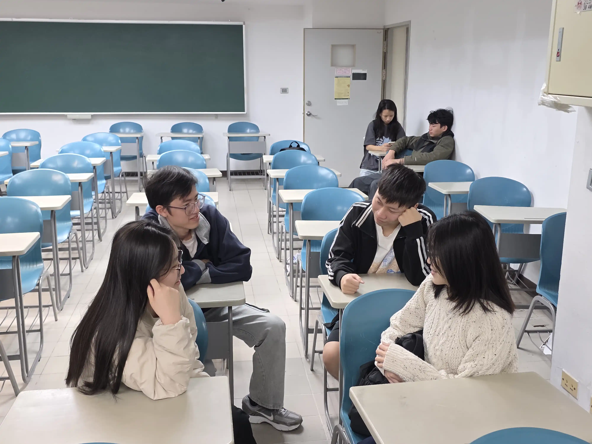

<div class="cover">
<h1>校園選課與課表規劃系統</h1>
<p class="big">系統需求設計規格書 V 3.0</p>
<p>Software Requirements Specification (SRS)<br>Software Design Document (SDD)</p>
<p class="members">A 索云（組長）<br>B 阿福<br>C Steve（副組長）<br>E 晴<br>F minnn</p>
<p>Department of Computer Science &amp; Information Engineering<br>National Taipei University of Technology</p>
<p>2026/11/24</p>
</div>

[TOC]

# 1 簡介 (Introduction)

## 1.1 目標 (Purpose)

本系統提供學生校園選課與課表規劃工具，協助管理課程資訊、檢查選課衝突及安排個人課表，提高選課效率並減少人工排課錯誤。

## 1.2 系統名稱 (Identification)

校園選課與課表規劃系統（Campus Course Registration and Timetable Planning System）

## 1.3 概觀 (Overview)

系統採 Python 命令列介面（CLI），提供課程與學生資料管理（F1）、選課衝突檢查（F2）、個人課表與空閒時段（F3）、校園活動與教室配置（F4）、課程篩選與可行性檢查（F5）及資料儲存（F6），並規劃最佳課表搜尋（F7）、演算法比較（F8）、校園路徑（F9）、動態重新規劃（F10）與 AI 輔助品質改善（F11）。各功能採模組化開發並以自動化測試驗證。

# 2 系統 (System)

## 2.1 系統描述 (System Description)

系統分為命令列介面、功能模組、共用規則與資料存取四部分。`Main.py` 處理輸入與顯示；各功能模組以函式提供服務，回傳狀態與錯誤代碼，不含介面文字；`StorageManager.py` 負責讀寫 JSON 檔案。

### 2.1.1 使用案例模型 (Use Case Model)

<svg viewBox="0 0 700 330" class="fig" xmlns="http://www.w3.org/2000/svg" font-size="14">
<rect x="170" y="10" width="510" height="310" fill="none" stroke="#555"/><text x="180" y="30" font-size="13">校園選課與課表規劃系統</text>
<g fill="none" stroke="#333"><circle cx="70" cy="125" r="14"/><path d="M70 139v45M45 155h50M70 184l-22 35M70 184l22 35"/></g><text x="55" y="240">學生</text>
<g fill="#fff" stroke="#333"><ellipse cx="330" cy="60" rx="125" ry="22"/><ellipse cx="330" cy="110" rx="125" ry="22"/><ellipse cx="330" cy="160" rx="125" ry="22"/><ellipse cx="330" cy="210" rx="125" ry="22"/><ellipse cx="330" cy="260" rx="125" ry="22"/><ellipse cx="590" cy="135" rx="80" ry="22"/></g>
<g text-anchor="middle"><text x="330" y="65">UC-01 課程與學生資料管理</text><text x="330" y="115">UC-02 加選與衝堂檢查</text><text x="330" y="165">UC-03 課表與空閒時段</text><text x="330" y="215">UC-04 活動與教室配置</text><text x="330" y="265">UC-05 條件式課程篩選</text><text x="590" y="140">時段衝突檢查</text></g>
<g stroke="#333"><path d="M98 150L205 62M98 152L205 112M98 156L205 160M98 160L205 208M98 164L205 258"/></g>
<g stroke="#333" stroke-dasharray="5 4"><path d="M455 112L512 130M452 204L520 148"/></g><text x="468" y="106" font-size="11">«include»</text><text x="495" y="188" font-size="11">«include»</text>
</svg>
<p class="cap">圖一、系統使用案例圖（F1～F5）</p>

UC-06 最佳課表搜尋屬 F7，於下一迭代開發。以下描述本迭代的代表案例：

| 項目 | 內容 |
| --- | --- |
| Use Case ID | UC-05 |
| 名稱 | 條件式課程篩選（F5） |
| 主要參與者 | 學生 |
| 目的 | 取得符合條件的候選課程，並得知條件是否可行 |
| 前置條件 | 系統已載入課程與學生資料 |
| 觸發事件 | 學生選擇選單 17「篩選課程並檢查可行性」 |
| 後置條件 | 顯示候選課程或不可行原因；資料不變 |

**主要成功流程**

1. 學生輸入學號。
2. 學生輸入必修清單、希望課程、最低及最高學分、不可上課時段與偏好星期。
3. 系統檢查條件格式，逐門篩選課程。
4. 系統檢查必修、學分與衝堂是否可行。
5. 系統顯示可行，並列出候選課程與被排除課程的原因。

**替代流程**

- 1a. 學號不存在：顯示找不到學生。
- 3a. 條件格式錯誤：顯示錯誤，不進行篩選。
- 4a. 條件矛盾、必修額滿或無法達到最低學分：一次列出所有原因。

**輸入**：S10902；必修 CS102；希望 CS102、GE101；最低 20 學分；星期四第 3 節不可上課；偏好星期三、四

**預期輸出**

```text
學生：S10902 林美玲
檢查結果：不可行
原因 1：必修課程 CS102 資料結構 落在不可上課時段
原因 2：最低需 20 學分，目前最多只能選 0 學分
不衝堂時最多可選學分：0
[查詢] 沒有符合條件的候選課程。
排除的課程：
  CS102 資料結構：落在不可上課時段
  GE101 哲學思考與現代生活：落在不可上課時段、已額滿
```

其餘案例見 [UseCase.md](https://github.com/Xoyiun/GuoLao-sGroupAssignment/blob/main/規格書與分工表/UseCase.md)。

### 2.1.2 系統架構圖 (System Architecture Diagram)

<svg viewBox="0 0 700 340" class="fig" xmlns="http://www.w3.org/2000/svg" font-size="13" text-anchor="middle">
<g fill="#fff" stroke="#333"><rect x="290" y="8" width="120" height="34"/><rect x="250" y="66" width="200" height="38"/><rect x="20" y="134" width="660" height="80" fill="#f5f5f5"/><rect x="35" y="160" width="100" height="42"/><rect x="145" y="160" width="100" height="42"/><rect x="255" y="160" width="90" height="42"/><rect x="355" y="160" width="100" height="42"/><rect x="465" y="160" width="95" height="42"/><rect x="570" y="160" width="95" height="42"/><rect x="60" y="244" width="250" height="38"/><rect x="390" y="244" width="250" height="38"/><rect x="390" y="300" width="250" height="34"/></g>
<text x="350" y="30">User</text><text x="350" y="90">CLI：Main.py</text><text x="75" y="152">功能模組</text>
<text x="85" y="178">F1 資料管理</text><text x="85" y="195" font-size="10">CourseDataManager</text><text x="195" y="178">F2 衝堂選課</text><text x="195" y="195" font-size="10">ConflictChecker</text><text x="300" y="178">F3 課表</text><text x="300" y="195" font-size="10">Timetable</text><text x="405" y="178">F4 活動場地</text><text x="405" y="195" font-size="10">VenueManager</text><text x="512" y="178">F5 篩選</text><text x="512" y="195" font-size="10">CourseFilter</text><text x="617" y="178">F7～F10</text><text x="617" y="195" font-size="10">初版</text>
<text x="185" y="267">共用規則：Constants、TimeSlotUtils</text><text x="515" y="267">F6 資料存取：StorageManager</text><text x="515" y="322">JSON：Courses／Students／Classroom</text>
<g stroke="#333" fill="none"><path d="M350 42v24M350 104v30M185 214v30M515 214v30M515 282v18"/></g>
</svg>
<p class="cap">圖二、系統架構圖</p>

## 2.2 系統資料 (System Data)

### 2.2.1 資料格式 (Data Format)

**學生**

| student_id | name | department | grade | enrolled_courses | max_credits |
| --- | --- | --- | --- | --- | --- |
| 學號 | 姓名 | 系別 | 年級 | 已選課程與已報名活動 | 學分上限 |
| S10902 | 林美玲 | 資工系 | 1 | CS101、CS102、ACT01 | 25 |

**課程與活動**（檔案欄位；載入後 `name`、`type`、`classroom` 對應為 `title`、`required`／`course_type`、`classroom_id`）

| course_id | name | credits | type | teacher | classroom | capacity | time_slots |
| --- | --- | --- | --- | --- | --- | --- | --- |
| GE101 | 哲學思考與現代生活 | 2 | unRequired | 趙教授 | T4-202 | 45 | 星期四 3、4 節 |
| ACT01 | 資工系迎新茶會 | 0 | event | NPC | TR-310 | 100 | 2026-10-06 第 5、6 節 |

課程的 `day` 為星期 1～7；活動的 `day` 為日期時間戳，比對時換算成星期。節次為 1～9、a、b、c。

**教室**

| room_id | capacity | equipment |
| --- | --- | --- |
| TR-310 | 60 | projector、mic、computer |
| IB-101 | 120 | projector、mic、computer、audio |

現有資料：20 門課程、15 名學生、3 項活動及 232 間教室。

# 3 軟體設計 (Software Design)

## 3.1 函式功能介面 (Functionality Interface)

各模組主要函式如下，完整程式碼連結列於右欄。

| 功能 | 主要函式 | 輸出 | 程式碼 |
| --- | --- | --- | --- |
| F1 | `AddCourse`、`UpdateCourse`、`DeleteCourse`、`QueryCourses`，學生與教室對應函式 | `(ok, code)` 或清單 | [CourseDataManager.py](https://github.com/Xoyiun/GuoLao-sGroupAssignment/blob/main/CampusPlanner/Code/CourseDataManager.py) |
| F2 | `CheckEnrollmentConflicts`、`EnrollCourse`、`DropCourse` | `(ok, code, conflicts)` | [ConflictChecker.py](https://github.com/Xoyiun/GuoLao-sGroupAssignment/blob/main/CampusPlanner/Code/ConflictChecker.py) |
| F3 | `build_timetable`、`query_timetable`、`find_free_slots_between`、`summarize_timetable` | 課表矩陣或清單 | [Timetable.py](https://github.com/Xoyiun/GuoLao-sGroupAssignment/blob/main/CampusPlanner/Code/Timetable.py) |
| F4 | `AddActivity`、`UpdateActivity`、`CancelActivity`、`QueryActivities`、`FindAvailableClassrooms`、`ExplainUnavailable` | `(ok, code, ...)` | [VenueManager.py](https://github.com/Xoyiun/GuoLao-sGroupAssignment/blob/main/CampusPlanner/Code/VenueManager.py) |
| F5 | `FilterCourses`、`CheckCourseFeasibility` | `(ok, code, ...)` | [CourseFilter.py](https://github.com/Xoyiun/GuoLao-sGroupAssignment/blob/main/CampusPlanner/Code/CourseFilter.py) |
| F6 | `LoadDatabase`、`SaveDatabase`、`NormalizeDatabase` | 資料庫與錯誤清單 | [StorageManager.py](https://github.com/Xoyiun/GuoLao-sGroupAssignment/blob/main/CampusPlanner/Code/StorageManager.py) |

### 代表函式：F2

| 項目 | 說明 |
| --- | --- |
| 函式名稱 | `CheckEnrollmentConflicts(database, studentId, courseId)` |
| 功能描述 | 加選前檢查所有衝堂與限制 |
| 輸入 | 資料庫、學號、課程或活動代號 |
| 輸出 | `(ok, code, conflicts)` |
| 前置條件 | 資料庫為標準格式 |
| 處理規則 | 檢查學生衝堂、活動衝突、教室衝堂、名額與學分；時段衝突依星期、節次排序，限制排最後 |
| 後置條件 | 不修改資料 |

### 代表函式：F5

| 項目 | 說明 |
| --- | --- |
| 函式名稱 | `CheckCourseFeasibility(database, criteria)` |
| 功能描述 | 篩選候選課程並檢查條件是否可行 |
| 輸入 | 資料庫；必修、希望課程、已選課程、最低／最高學分、不可上課時段、偏好星期 |
| 輸出 | `(ok, code, report)`，含候選課程、排除原因、最多可選學分與所有問題 |
| 前置條件 | 資料庫為標準格式 |
| 處理規則 | 檢查查無課程、條件矛盾、必修額滿及最低學分；計算學分時排除互相衝堂的組合 |
| 後置條件 | 不修改資料 |

```python
import CourseFilter as courseFilter

ok, code, report = courseFilter.CheckCourseFeasibility(database, {
    "required_ids": ["CS102"],
    "min_credits": 20,
    "blocked_slots": [{"day": 4, "period": "3"}],
})
# CS102 在星期四第 3 節 → ok 為 False，code 為 "CONFLICTING_CRITERIA"
```

# 4 專案管理 (Project Management)

## 4.1 工作分解表 (Work Breakdown Structure)

依 [工作分解表 v2](https://github.com/Xoyiun/GuoLao-sGroupAssignment/blob/main/規格書與分工表/工作分解表v2.md)。D 竹已退選；F3 由 D 竹於迭代二完成。

| 組員 | 擔任角色 | 主要負責工作 | 協作／檢視 |
| --- | --- | --- | --- |
| A 索云 | 組長、系統整合 | WBS、Git 版控、系統架構、CLI 整合 | 最終 Code Review |
| B 阿福 | 需求分析、資料管理 | 需求規格、Use Case、F1、F6 | 監督者：E 晴 |
| C Steve | 副組長、選課邏輯與搜尋 | F2、F5、F7 | 監督者：F minnn |
| E 晴 | 地圖路徑、動態重排 | F9、F10 | 監督者：B 阿福 |
| F minnn | 測試架構、品質監督 | F8、F6 測試架構、F11 | 監督者：C Steve |

上表為分工規劃；實際提交者以 4.2、4.3 節的 Git 紀錄為準。原分配給 D 竹的 F4，本迭代由 F minnn 與 A 索云補強。

迭代三工作分解：

1. 活動與教室配置（F4）
    - 1.1 輸入驗證與測試：F minnn
    - 1.2 修改、取消、查詢、自動配對與原因說明：A 索云
2. 課程篩選與可行性檢查（F5）
    - 2.1 篩選初版：A 索云
    - 2.2 可行性檢查、測試與 CLI：C Steve
3. 資料儲存與系統測試（F6）
    - 3.1 CI 與測試報告：A 索云
    - 3.2 回歸測試：全系統 220 項
4. 影片 I：A 索云整合，團隊成員錄製

## 4.2 版本控管 (Version Control)

Git Repository：[https://github.com/Xoyiun/GuoLao-sGroupAssignment](https://github.com/Xoyiun/GuoLao-sGroupAssignment)

本迭代主要版本紀錄：

| Commit | 負責人 | 內容 |
| --- | --- | --- |
| `d2ae846` | F minnn | F4 驗證補強與 20 項測試（PR #36） |
| `33f2872` | C Steve | 影片 I 附件、F2 排序測試 2 項（PR #41） |
| `37b0b31` | A 索云 | GitHub Actions 自動測試 |
| `1023ade`、`4ba3bb8` | A 索云 | HTML 測試報告與 CI 測試摘要 |
| `cb63dfc` | A 索云 | F4 活動流程、F5 最低學分、F7～F10 初版補強與測試 |
| `d41bd37` | C Steve | F5 可行性檢查、CLI 選單 17 與 24 項測試 |

## 4.3 專案審查 (Iteration Review)

### 4.3.1 Iteration 1

**系統版本與功能完成表**

| 測試通過 | 已完成 | 開發中 | 未開始 |
| --- | --- | --- | --- |
| F1 | — | F6 | F2～F5、F7～F11 |

**需求／設計修改**：程式搬入 `CampusPlanner` 架構；時段常數移至資料存取模組共用；教室設備清單每一項須為文字。

**Git**：`03be675`、`38dd680`（C Steve）F1 核心程式與測試；`2759564`、`d17e538`（A 索云）專案結構與文件；`9ba5595`（C Steve）CLI。

**自動化測試與缺陷**：112 項通過。D01、D02 已修正。

**Iteration Review**

- 完成：F1 CRUD、CLI 與 JSON 存取。
- 未完成：教室修改與條件查詢、F2～F5、F7～F10。
- 問題：原測試只測欄位缺漏，未測欄位格式錯誤。
- 下次改善：統一資料格式，整合前先執行自動化測試。

### 4.3.2 Iteration 2

**系統版本與功能完成表**

| 測試通過 | 已完成 | 開發中 | 未開始 |
| --- | --- | --- | --- |
| F1、F2、F3、F6 | — | F4、F5、F7～F10 | F11 |

**需求／設計修改**：課程與學生改為依 ID 分檔；活動改為 event 課程，報名統一記在 `enrolled_courses`；加選、退選須同時更新學生清單與課程人數；空堂可跨日查詢但不跨越午夜。

**Git**：`15feb67`（A 索云）分檔與模組初版；`5de6cf4`、`c2b43a9`、`1d7668e`、`abaa44c`（C Steve）F2 與資料修正；`67c19dd`～`44ecc4f`（D 竹）F3。

**自動化測試與缺陷**：157 項通過。D03～D15 已修正。

**Iteration Review**

- 完成：F2、F3 與 CLI；F4 需求分析與介面設計。
- 未完成：F4 完整實作、F5～F10 測試。
- 問題：部分修改未經 Pull Request；同一份報名資料記在兩處。
- 下次改善：先開 PR 並留下 Review 意見；每份資料只記一處。

### 4.3.3 Iteration 3

**系統版本與功能完成表**

本週交付整合版 v1.0。執行 `uv run python CampusPlanner/Code/Main.py` 啟動，`uv run python TestDriver.py` 執行測試。

| 測試通過 | 已完成 | 開發中 | 未開始 |
| --- | --- | --- | --- |
| F1、F2、F3、F5、F6 | — | F4、F7、F8、F9、F10 | F11 |

F4 的函式已通過 25 項測試，但尚無 CLI 入口，活動資料 3 項，未達驗收要求的 10 項，故列為開發中。F7～F10 為初版，依時程於後續迭代開發。

**需求／設計修改**

| 修改 | 原因 |
| --- | --- |
| F4 失敗時回傳明確錯誤碼且資料不變 | 避免活動只新增一半 |
| F5 必修不受偏好星期限制；活動不列為候選 | 偏好不是硬性條件；活動不是課程 |
| F5 最低學分改為排除衝堂後計算 | 學分合計足夠不代表排得進課表 |
| F5 新增最高學分、希望課程與選單 17 | 補齊規範輸入 |
| 新增 GitHub Actions | push 與 PR 自動執行測試並保留報告 |

**Git**：見 4.2 節。

**自動化測試與缺陷**：220 項全部通過（5.2 節）。

**Iteration Review**

- 完成：F5、F4 主要函式、CI 與測試報告、影片 I。
- 未完成：F4 的 CLI、10 項活動資料、多人報名與額滿的 F4 測試。
- 問題：Kdenlive 專案合併時設定衝突；系統 Python 未安裝 pytest 時無法直接測試。
- 下次改善：補齊 F4 驗收；F7 起依 TDD 保留 Red、Green、Refactor 紀錄。

## 4.4 AI 協作紀錄 (AI Collaboration Record)

### 4.4.1 Iteration 2 AI 協作紀錄

| 項目 | 內容 |
| --- | --- |
| 紀錄期間 | 10/20～11/08 |
| 協作主題 | F2 多層次衝堂與選課檢查 |
| 使用工具 | Claude Code |

**F2 驗收條件檢查**（10/28 對話）

| 提示詞 | AI 建議摘要 | 採納情況與理由 | 驗證方式與結果 |
| --- | --- | --- | --- |
| 你會怎麼優化 | 列出多項建議，並判斷「活動衝突檢查形同虛設」；提議先對照 F2 驗收條件檢查 | 採納對照驗收條件的提議 | 「形同虛設」為誤判：活動已存成 event 課程，原檢查有效。AI 讀完程式後更正 |
| 好 幫我處理 | 補上教室衝堂、依星期與節次排序、重複加選回報 `ALREADY_ENROLLED` | 採納，可對應驗收條件 | AI 修改後新增 8 項測試；換回舊程式時 3 項失敗，新程式全部通過 |

**種子資料教室撞期**（10/28 對話）

| 提示詞 | AI 建議摘要 | 採納情況與理由 | 驗證方式與結果 |
| --- | --- | --- | --- |
| 所以現在會爆出衝堂 阿資料本身是錯的是什麼意思 | 程式正確，CS102 與 MA101 的資料從迭代零就撞教室；提出 A、B 兩方案 | 採納 A：CS102 改至星期四 | 加選兩門課皆成功；新增種子資料不得撞教室的測試 |

### 4.4.2 Iteration 3 AI 協作紀錄

| 項目 | 內容 |
| --- | --- |
| 紀錄期間 | 11/09～11/24 |
| 協作主題 | F4 校園活動與教室配置、F5 課程篩選、CI 測試報告 |
| 使用工具 | AI 助理、Claude Code |

**F4 活動配置**（取自團隊週報）

| 提示詞 | AI 建議摘要 | 採納情況與理由 | 驗證方式與結果 |
| --- | --- | --- | --- |
| 請對照 F4 需求與 `VenueManager.py`，找出尚未測試的正常、邊界及錯誤情境。 | 先驗證所有輸入再寫入；失敗時資料不得被部分修改 | 採納，對應需求與錯誤碼 | 新增 20 項測試，全部通過 |
| 活動容量、設備與教室時段同時不符合時應如何處理？ | 依序驗證並回傳明確錯誤碼 | 採納，可辨識實際失敗原因 | 容量、設備、重複代號、教室衝突與資料完整性案例均通過 |

**F5 可行性檢查**（11/24 對話）

| 提示詞 | AI 建議摘要 | 採納情況與理由 | 驗證方式與結果 |
| --- | --- | --- | --- |
| 先補 F5 | 保留初版介面，新增一次列出所有原因的可行性檢查 | 採納，補齊規範輸入與五種以上情境 | 新增 24 項測試先全部失敗，實作後全系統 220 項通過 |

**CI 測試報告**（取自團隊週報）

| 提示詞 | AI 建議摘要 | 採納情況與理由 | 驗證方式與結果 |
| --- | --- | --- | --- |
| 如何讓 CI 在測試失敗時仍保留測試報告，並顯示各模組統計？ | 以 JUnit XML 統計，報告步驟使用 `if: always()` | 採納，避免缺少除錯資料 | GitHub Actions 產生 XML、HTML 與 Summary |

## 4.5 程式碼檢視 (Code Review)

### 4.5.1 Iteration 1

A 索云檢視 C Steve 的 F1 程式（PR #21）與模組搬移（PR #25）。PR #25 提出意見：檔案轉移會影響其他報告的內容；後續已將 SRS 與資料模型的路徑同步更新。

### 4.5.2 Iteration 2

C Steve 檢視 A 索云的 F2 初版，發現未檢查教室衝堂、衝突未排序、重複加選誤報，已修正（D04～D06）。C Steve 檢視 D 竹的 F3，發現活動判斷欄位錯誤、缺少跨日查詢與測試，已修正（D13）。

### 4.5.3 Iteration 3

F minnn 檢視 `VenueManager.py`，發現不合法活動仍可加入資料庫，補上驗證與 20 項測試。C Steve 於 AI 協助下檢視 A 索云的 `CourseFilter.py` 初版，發現缺最高學分與希望課程、偏好星期會排除必修、未考慮衝堂，於 `d41bd37` 修正。A 索云檢視並核准 PR #36、#41；PR #36 曾要求將文件移至迭代 3 資料夾，修改後合併。`d41bd37` 尚未由非原開發者檢視。

# 5 軟體測試 (Software Testing and Verification)

## 5.1 測試案例設計 (Test case design)

自 F1～F6 的自動化測試挑選 30 案作為代表，正常、邊界、錯誤與衝突各 10 案，每案標示對應的測試函式。各案例使用獨立的初始資料，可重複執行。

### 正常案例

| 編號 | 功能 | 測試情境與輸入 | 預期結果 | 測試函式 |
| --- | --- | --- | --- | --- |
| TC01 | F1 | 新增合法課程 | 成功，初始人數為 0 | `test_N01AddCourse` |
| TC02 | F1 | 修改學生姓名與學分上限 | 資料確實更新 | `test_N05UpdateStudent` |
| TC03 | F1 | 依教師查詢「林教授」 | 只有 CS101 與 CS203 | `test_N07QueryByTeacher` |
| TC04 | F2 | 加選有名額且無衝突的課 | 學生清單與課程人數同步更新 | `test_EnrollUpdatesStudentAndCourseTogether` |
| TC05 | F2 | 退選已選課程 | 移出清單，人數不低於 0 | `test_DropCourse` |
| TC06 | F3 | 同一天多門課、同一課一週多次 | 所有時段正確顯示 | `test_SameDayMultipleCoursesAndRepeatedCourse` |
| TC07 | F4 | 未指定教室，多間符合 | 選擇容量最小的可用教室 | `test_AutoMatchSelectsSmallestAvailableRoom` |
| TC08 | F4 | 修改後取消活動 | 更新成功；取消後移除活動與報名 | `test_UpdateAndCancelActivityAreAtomicAndReleaseRoom` |
| TC09 | F5 | 必修、禁止時段、偏好星期與學分皆可滿足 | 列出候選課程與排除原因 | `test_FeasiblePlanReportsCandidatesAndExclusionReasons` |
| TC10 | F6 | 新增課程後重新啟動 | 載入上次存檔的資料 | `test_RestartLoadsPreviousSaveAndTestInputUntouched` |

### 邊界案例

| 編號 | 功能 | 測試情境與輸入 | 預期結果 | 測試函式 |
| --- | --- | --- | --- | --- |
| TC11 | F1 | 人數上限為 1 | 新增成功 | `test_B01CapacityExactlyOne` |
| TC12 | F1 | 人數上限降至目前人數 | 修改成功 | `test_B10UpdateCapacityDownToEnrolledCount` |
| TC13 | F1 | 時段含星期 1 與星期 7 | 新增成功 | `test_B04Day1AndDay7` |
| TC14 | F2 | 活動跨 10/8（四）與 10/12（一） | 換算星期後，星期一衝突在前 | `test_ActivityDatesAreSortedByWeekdayNotByTimestamp` |
| TC15 | F2 | 第 9 節與第 a 節皆衝堂 | 第 9 節在前 | `test_PeriodsLettersSortAfterNine` |
| TC16 | F3 | 兩節與四節的空檔，要求至少三節 | 只回傳四節的空檔 | `test_ConsecutiveThreeFreePeriods` |
| TC17 | F3 | 星期一至星期三的跨日查詢 | 每天分開計算，不跨越午夜 | `test_CrossDayQuery` |
| TC18 | F4 | 14:00～16:30 換算節次 | 第 6、7、8 節 | `test_TimeRangeToSlotsUsesOverlappingPeriods` |
| TC19 | F5 | 學分恰等於上下限；每門 3 學分要湊 4～5 | 前者可行，後者不可行 | `test_CreditBoundariesAndUnreachableExactRange` |
| TC20 | F6 | 資料夾不存在 | 空資料庫並記錄原因 | `test_PMissingDirectoryGivesEmptyDb` |

### 錯誤與衝突案例

| 編號 | 功能 | 測試情境與輸入 | 預期結果 | 測試函式 |
| --- | --- | --- | --- | --- |
| TC21 | F1 | 重複課程代號 | `DUPLICATE_ID` | `test_E01DuplicateCourseId` |
| TC22 | F1 | 學分為 0 | `INVALID_CREDITS` | `test_E05InvalidCreditsZero` |
| TC23 | F1 | 刪除已有學生選修的課程 | 拒絕，課程仍在 | `test_E09DeleteCourseWithStudentsRejected` |
| TC24 | F2 | 同時學生衝堂、教室衝堂、額滿、學分超過 | 全部列出並排序 | `test_AllConflictsListedAndSortedByDayAndPeriod` |
| TC25 | F2 | 有衝突時加選 | 拒絕，資料不變 | `test_EnrollWithConflictChangesNothing` |
| TC26 | F4 | 指定教室已被占用 | `ROOM_CONFLICT`，資料不變 | `test_AddActivityReportsRoomConflictAndKeepsDatabaseUnchanged` |
| TC27 | F4 | 無教室符合容量與設備 | 說明未滿足的條件 | `test_ExplainUnavailableReportsCapacityAndEquipment` |
| TC28 | F5 | 學分上下限矛盾、必修落在禁止時段且互相衝堂 | 一次列出全部原因 | `test_ContradictoryCriteriaAreAllListed` |
| TC29 | F5 | 四門共 12 學分，其中兩門衝堂，最低 12 | 回報最多 9 學分 | `test_EnoughTotalButOverlappingCoursesStillUnmet` |
| TC30 | F6 | 單一課程檔損毀 | 略過並備份，其他資料照常載入 | `test_PCorruptedFileBackedUpOthersLoaded` |

實際測試程式：[TestDriver](https://github.com/Xoyiun/GuoLao-sGroupAssignment/tree/main/TestDriver)

## 5.2 測試報告 (Test Report)

執行版本／Git Commit：`d41bd37`　測試日期：2026/11/24　指令：`uv run python TestDriver.py`

| 測試類型 | 通過案例 | 失敗案例 | 通過數 |
| --- | --- | --- | --- |
| 正常 | TC01～TC10 | 無 | 10／10 |
| 邊界 | TC11～TC20 | 無 | 10／10 |
| 錯誤與衝突 | TC21～TC30 | 無 | 10／10 |
| 合計 | 30 案 | 0 案 | 30／30（100%） |

完整回歸測試：

```text
220 passed
```

| 分類 | 數量 | 分類 | 數量 | 分類 | 數量 |
| --- | --- | --- | --- | --- | --- |
| F1 正常 | 10 | CLI | 44 | F7 | 2 |
| F1 邊界 | 11 | F2 | 14 | F8 | 1 |
| F1 錯誤 | 10 | F3 | 9 | F9 | 3 |
| F1 補充 | 43 | F4 | 25 | F10 | 3 |
| F6 存取 | 16 | F5 | 24 | 驗收資料 | 5 |

本報告為本機執行結果；`d41bd37` 尚未經 GitHub Actions 執行。

## 5.3 缺陷紀錄 (Defect Records)

| 編號 | 功能 | 缺陷 | 重現步驟 | 預期結果 | 狀態 |
| --- | --- | --- | --- | --- | --- |
| D01 | F6 | 欄位格式錯誤載入後查詢當掉 | `time_slots` 寫成字串後查詢 | 略過該筆並記錄 | 已修正 |
| D02 | F1 | 設備清單可含非文字 | 新增 `equipment=[1, 2]` | `INVALID_FIELD` | 已修正 |
| D03 | 測試 | 22 項測試讀取已刪除檔案 | 執行 `test_main.py` | 正常執行 | 已修正 |
| D04 | F2 | 加選未檢查教室衝堂 | 加選與他課同教室同時段的課 | `ROOM_CONFLICT` | 已修正 |
| D05 | F2 | 衝突未排序 | 多筆衝突時加選 | 依星期、節次排序 | 已修正 |
| D06 | F2 | 重複加選誤報衝堂 | 再次加選同一門課 | `ALREADY_ENROLLED` | 已修正 |
| D07 | 資料 | CS102 與 MA101 撞教室 | 比對 IB-101 星期二 3、4 節 | 不撞教室 | 已修正 |
| D08 | 資料 | 學生少於 15 名 | 計算學生檔 | 15 名 | 已修正 |
| D09 | F6 | 存檔重寫所有檔案 | 新增一筆後檢查檔案時間 | 只寫變動檔案 | 已修正 |
| D10 | F6 | 首次存檔改寫教室檔 | 存檔後比對 | 內容不變 | 已修正 |
| D11 | F1 | 新增或修改課程未查教室 | 排入已占用教室 | `ROOM_CONFLICT` | 已修正 |
| D12 | CLI | 測試尋找舊標題 | 執行啟動測試 | 通過 | 已修正 |
| D13 | F3 | 活動判斷欄位錯誤 | 報名活動後看課表 | 活動出現在課表 | 已修正 |
| D14 | 資料 | 報名記在兩處不一致 | 比對活動檔與學生檔 | 只記一處 | 已修正 |
| D15 | 測試 | CLI 測試減少為 3 項 | 計算 CLI 測試 | 補回測試 | 已修正 |
| I3-01 | 環境 | 系統 Python 未安裝 pytest | 執行 `python TestDriver.py` | 可執行測試 | 改用 `uv run` |
| I3-02 | CI | 測試失敗時未保留報告 | 測試失敗後檢查步驟 | 仍產生報告 | 已修正 |
| I3-03 | CI | 終端機輸出不易看各模組結果 | 查看 CI 頁面 | 有模組統計 | 已修正 |
| I3-04 | F4 | 缺活動修改、取消、查詢等函式 | 呼叫活動流程 | 完整活動流程 | 函式已完成；CLI 待補 |
| I3-05 | 影片 | Kdenlive 合併設定衝突 | 合併專案檔 | 可播放編輯 | 已修正 |
| I3-06 | F5 | 偏好星期會排除必修 | 必修不在偏好星期 | 必修仍保留 | 已修正 |
| I3-07 | F5 | 互相衝堂的課一併計入學分 | 見 TC29 | 最多 9 學分 | 已修正 |
| I3-08 | F4 | 活動資料 3 項，未達 10 項 | 計算活動檔 | 至少 10 項 | 待補 |

# 詞彙表 Glossary

| 詞彙 | 說明 |
| --- | --- |
| CLI | 命令列介面 |
| CRUD | 新增、查詢、修改、刪除 |
| CI | 持續整合，自動執行測試 |
| event 課程 | 以課程格式保存的活動，學分為 0 |
| 時段 | 星期或日期與節次的組合 |
| 回歸測試 | 修改後重新執行既有測試 |

# 參考 References

1. [專案 Git Repository](https://github.com/Xoyiun/GuoLao-sGroupAssignment)
2. 1151 計算機程式設計團體作業規範
3. 系統需求設計規格書 V3.0 範本（1151PD_SRSSDD）
4. 工作分解表 v2、需求規格書、Use Case

# 附錄 Appendix

## A. 團隊討論照片（2026/11/11）



## B. 影片 I

影片檔、逐字稿與附件置於繳交資料夾的「其他檔案／影片I」。
